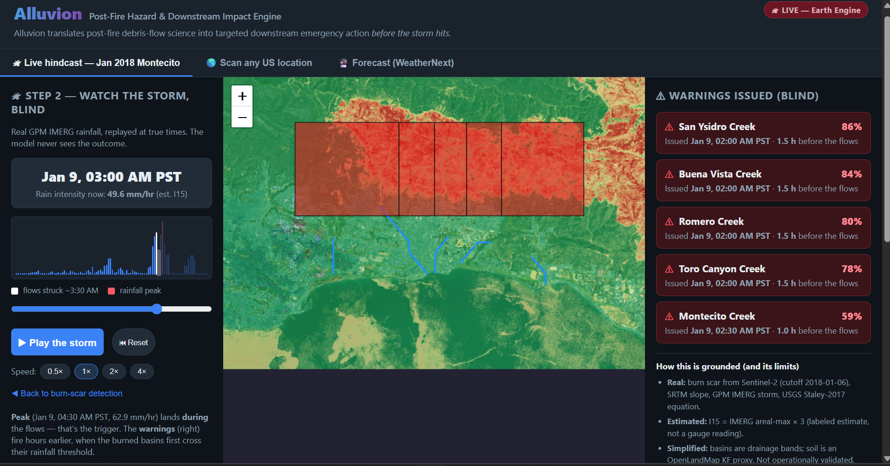
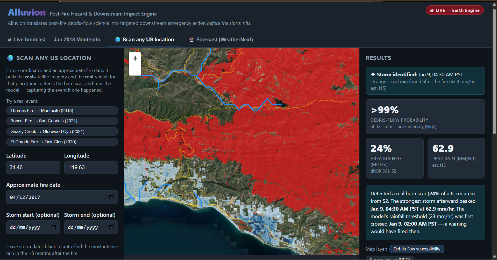
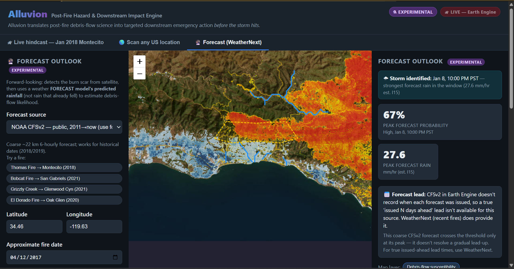

# Alluvion

Alluvion is a prototype early-warning tool for post-fire debris flows.

A debris flow is a fast, deadly mudslide. It can happen when heavy rain falls on a hillside that recently burned. Alluvion finds the burn scar from satellite images, works out how likely a debris flow is during a storm, and shows what sits downstream: people, buildings, roads, rivers and farmland.

**Live demo:** https://alluvion-live.vercel.app

**Pitch deck:** [docs/Alluvion-Pitch-Deck.pptx](docs/Alluvion-Pitch-Deck.pptx) — the vision and the Montecito validation case.

> **Please wait on the first load.** The backend runs on a free server that falls asleep when nobody uses it. The first visit can take 30 to 60 seconds. The page says "Connecting to Google Earth Engine" until the server wakes up. After that it is fast.

> **Not a safety system.** This is a student prototype. It has not been checked against real operations. Always follow official warnings from USGS, the National Weather Service and local emergency teams.

---



## What the app does

The app has three tabs.

**1. Live hindcast (Jan 2018 Montecito)**
This replays a real disaster "blind". The app only uses data from before 6 January 2018. It detects the burn scar from Sentinel-2 satellite images. Then it plays the real storm of 9 January 2018 hour by hour and shows a warning for each creek when its debris-flow probability crosses 50%.

**2. Scan any US location**
You type in a latitude, longitude and an approximate fire date. The app finds the burn scar for that place, searches the next 8 months for the strongest storm, and runs the model. There are four preset fires you can click: Thomas Fire, Bobcat Fire, Grizzly Creek and El Dorado Fire.



**3. Forecast (experimental)**
This uses a weather forecast instead of rain that already fell. You can pick NOAA CFSv2, which is public. Google WeatherNext is also listed, but it needs special access and is switched off on the live demo.



For every result the app can also count what is downstream (exposure) and write an advisory.

---

## An example result

This is what the live Montecito replay returns. The creeks are from west to east.

| Creek | Burn severity (dNBR) | Steep and burned share | Warning time (UTC) | Probability at warning |
|---|---|---|---|---|
| Montecito Creek | 147 | 0.12 | 10:30, 9 Jan 2018 | 59% |
| San Ysidro Creek | 417 | 0.43 | 10:00, 9 Jan 2018 | 86% |
| Buena Vista Creek | 397 | 0.44 | 10:00, 9 Jan 2018 | 84% |
| Romero Creek | 350 | 0.43 | 10:00, 9 Jan 2018 | 80% |
| Toro Canyon Creek | 357 | 0.37 | 10:00, 9 Jan 2018 | 78% |

The app counts the debris flows as starting at 11:30 UTC. So the warnings come about 1 to 1.5 hours earlier. Earlier than that you can watch the basins warm up: by the afternoon before the flows (around 12 hours out) they are already in the moderate range (about 35 to 40% probability, shaded orange on the map), well before any formal warning fires. The rain here is an estimate from satellite data, so treat these numbers as a demonstration, not a measurement.

---

## How it works

Each scan follows the same steps.

1. **Burn scar.** The app takes Sentinel-2 images from before and after the fire and subtracts them. The result is called dNBR. A bigger number means a worse burn.
2. **Terrain and soil.** It reads the slope from an elevation map (SRTM) and estimates how easily the soil washes away (from OpenLandMap soil data).
3. **Rain.** It reads satellite rainfall (GPM IMERG) for the storm and turns it into an estimated peak 15-minute rain intensity.
4. **Probability.** It puts burn, slope, soil and rain into the USGS Staley (2017) M1 equation. The result is a probability that a debris flow happens.
5. **Exposure.** It counts people, buildings, roads, rivers and farmland in the valley area below the burned slopes.
6. **Advisory.** If the probability is above 50%, it writes a short warning report.

The full explanation, with the equation, is in [docs/GUIDE.md](docs/GUIDE.md).

---

## Data sources

All data comes live from Google Earth Engine.

| What | Dataset |
|---|---|
| Burn scar | Sentinel-2 (2016 and later), Landsat 8 |
| Slope | SRTM elevation |
| Soil erodibility | OpenLandMap soil data |
| Rain that fell | GPM IMERG |
| Forecast rain | NOAA CFSv2 (WeatherNext if access is granted) |
| People | WorldPop |
| Buildings | JRC GHSL built-up surface |
| Roads | US Census TIGER |
| Rivers | WWF HydroSHEDS |
| Farmland | USDA Cropland Data Layer |

---

## Built with

* **Backend:** Python, FastAPI, the Google Earth Engine API, NumPy
* **Frontend:** React 18, Vite, Leaflet maps
* **Hosting:** Render (backend, free plan) and Vercel (frontend, free plan)

---

## Project structure

```
alluvion-live/
  README.md          this file
  docs/
    GUIDE.md         how it works, the science, the API, the limits
    DEPLOY.md        how to run it locally and deploy it
    Alluvion-Pitch-Deck.pptx   pitch deck (vision + Montecito case)
    img/             screenshots used in this README
  backend/           FastAPI server and the Earth Engine pipeline
    app/main.py      the API endpoints
    pipeline/        burn scan, rain, model, exposure, forecast, report
    requirements.txt
    render.yaml      optional Render setup file
  frontend/          React map website
    src/             the app code
    vercel.json      Vercel settings
```

---

## Run it yourself

You need a Google Earth Engine account and a Google Cloud project. The quick version is below. The full click-by-click guide is in [docs/DEPLOY.md](docs/DEPLOY.md).

**Backend** (first terminal):

```
cd backend
python -m venv .venv
.venv\Scripts\activate
pip install -r requirements.txt
earthengine authenticate
set EE_PROJECT=your-google-cloud-project-id
uvicorn app.main:app --port 8000
```

On macOS or Linux, use `source .venv/bin/activate` and `export EE_PROJECT=...` instead.

**Frontend** (second terminal):

```
cd frontend
npm install
npm run dev
```

Open http://localhost:5173.

---

## Settings

These are environment variables. Never put real keys in the code or in this repository.

| Name | Where | What it does |
|---|---|---|
| `EE_SERVICE_ACCOUNT_JSON` | backend | The full Earth Engine service-account key. This is how the live site signs in. |
| `EE_PROJECT` | backend | Your Google Cloud project ID (needed for local sign-in). |
| `GEMINI_API_KEY` | backend | Optional. Lets Gemini write the advisory. Without it a built-in template is used. |
| `GMAIL_ADDRESS`, `GMAIL_APP_PASSWORD` | backend | Optional. Lets you email an advisory. |
| `GOOGLE_MAPS_API_KEY` | backend | Optional. Finds hospitals, schools and fire stations. |
| `ENABLE_WEATHERNEXT` | backend | Set to `true` only after Google gives you WeatherNext access. |
| `VITE_API_BASE` | frontend | The backend web address. Set on Vercel. |

---

## Limits

* **US only.** The soil data covers the United States.
* **Not validated.** It has not been tested as a real safety system.
* **Simple basins.** Drainage basins are simplified bands, not true watersheds.
* **Estimated rain peak.** The 15-minute rain intensity is estimated from coarse satellite data. It is not a rain gauge reading.
* **Coarse forecast.** CFSv2 is about 22 km wide, so it blurs short, strong storms.
* **No automatic fire detection.** You tell it where and when to look.
* **Slow first load.** The free server sleeps (see the note at the top).

More detail is in [docs/GUIDE.md](docs/GUIDE.md).

---

## Credits and honesty

Alluvion was **designed, specified and directed by Fahad Asif**. **All of the code was written by Claude (Anthropic)**, following that design.

The science is not mine. The debris-flow equation is from the US Geological Survey:

> Staley, D.M., Negri, J.A., Kean, J.W., Laber, J.L., Tillery, A.C., Youberg, A.M. (2017). Prediction of spatially explicit rainfall intensity-duration thresholds for post-fire debris-flow generation. *Geomorphology*, 278, 149-162.

Data and platform: Google Earth Engine, ESA Sentinel-2, NASA GPM IMERG, NOAA CFSv2, WorldPop, JRC GHSL, US Census TIGER, WWF HydroSHEDS and USDA CDL.
